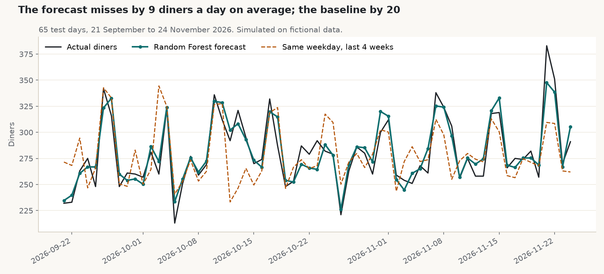

# Evidence

This file collects every metric, chart and test result in one place for the showcase slides. Each phase adds its section, and every result here is simulated on fictional data.

## Phase 0: setup and static screens

Phase 0 has no models, so its evidence is the test suite and the screen comparison. The test suite (`python -m pytest -q`) checks the configuration, the colour tokens from CLAUDE.md, text contrast of at least 4.5:1 for every text and background pair in both modes, the absence of em dashes in on-screen copy, the "Fictional data" labels, accessible names for symbol-only buttons, that all five pages build, and that no API key is committed.

## Phase 1: synthetic data

This section shows that the fictional hotel's year of breakfasts behaves as intended, before any model sees it. The data covers 365 breakfasts at a fictional 300-room Singapore city hotel from 25 November 2025 to 24 November 2026. It is simulated on fictional data, with every assumption and its source in `docs/ASSUMPTIONS.md`.

The data was frozen on 21 November 2026, before Phase 2 began. The file `data/synthetic_breakfast.csv` (365 rows, 65 columns, generated with seed 20261124) has the SHA-256 checksum `86846b20aca06899e35f41c1546282924d0ccd92a01cb5f8f375dc1df7497022`, and `tests/test_data_gen.py` fails if it changes.

The year averages 282 diners a day (265 on weekdays and 319 at weekends and on public holidays, from 200 to 412), with 83% occupancy, 78.3% of rooms including breakfast and check-ins from 21% of diners. There are 37 group days and 32 surprise days (14 rain, 13 early tour groups, 4 early events and 1 quiet morning).

Weekday arrivals peak in the 07:30 slot (11.1% of the morning), with 39% of diners arriving between 07:00 and 08:00. Weekend and public holiday arrivals peak in the 09:00 slot (12.9%), with 48% arriving between 08:30 and 09:30.

Under the baseline chef rule (same-weekday average over four weeks plus 15%), an average day has these amounts per dish, with croissants converted at 60 g each:

| Dish | Prepared (kg) | Eaten (kg) | Left (kg) | Left (% of prepared) | Days demand exceeded the plan | Cost of leftovers (S$ a day) |
| --- | --- | --- | --- | --- | --- | --- |
| Scrambled eggs | 22.3 | 19.0 | 3.3 | 14.8 | 47 | 16.52 |
| Chicken sausages | 15.9 | 13.3 | 2.6 | 16.3 | 27 | 19.37 |
| Hash browns | 11.6 | 9.6 | 1.9 | 16.7 | 32 | 7.69 |
| Pancakes | 7.3 | 6.1 | 1.1 | 15.7 | 55 | 5.12 |
| Mee goreng | 16.4 | 13.6 | 2.8 | 17.1 | 33 | 9.79 |
| Nasi lemak rice | 19.1 | 16.0 | 3.1 | 16.3 | 40 | 7.75 |
| Croissants | 8.5 | 6.8 | 1.7 | 20.4 | 24 | 20.79 |
| Cut fruit | 22.4 | 18.5 | 4.0 | 17.6 | 28 | 19.00 |
| **Total** | **123.3** | **102.8** | **20.5** | **16.6** | | **106** |

That is 73 g of leftovers per diner, close to the 62.2 g per guest measured by the Dutch Hotel Monitor, and about S$38,700 a year. It is about half the "usual day" on the day-end report design (41.2 kg, S$214), so later phases will compare BuffetIQ with these simulated figures rather than the design's sample numbers.

The sanity tests in `tests/test_data_gen.py` (17 tests) check that there are no negative numbers, that arrivals add up to diners every day, that leftover equals prepared minus consumed, that prepared amounts are whole batches, that monthly occupancy is within 1 point of the STB figures, that the weekday and weekend peaks fall in the required windows, that children raise pancake demand, that surprises occur on 3% to 11% of days and that check-in response never exceeds 40%. All 96 tests in the project pass.

## Phase 2: demand forecast for the night before

This section shows whether the night-before forecast is better than what a kitchen does today. The forecast predicts how many guests will eat, when they will arrive in each 15-minute slot, and how much of each dish they will need, using only what the hotel knows the evening before. It is compared with the usual planning shortcut, the average of the same weekday over the previous four weeks. Every result is simulated on fictional data, and the numbers come from `python -m buffetiq.forecast` (run from `src`), also available as `notebooks/02_evaluate_forecast.ipynb`, with the raw output in `docs/phase2_results.json`.

The models are trained on the first 300 days (25 November 2025 to 20 September 2026) and tested once on the last 65 (21 September to 24 November 2026), so they never see the future. Every choice of settings and method was made on the training days alone, through time-ordered cross-validation (each fold is predicted by a model trained only on earlier days). Error is reported as MAE (mean absolute error, the average miss), RMSE (root mean squared error, which punishes large misses more) and MAPE (mean absolute percentage error).

### Diners

A Random Forest (an average of 300 decision trees) uses the day of week, the weekend, public holiday and school holiday flags, occupancy, adults and children in house, breakfast-inclusive rooms, the business guest share, the group booking flag and guest-page check-ins. Its best settings from the training days were trees grown to a maximum depth of 12 with leaves of one day.

| Method | MAE (diners) | RMSE (diners) | MAPE |
| --- | --- | --- | --- |
| Random Forest | 9.1 | 11.8 | 3.2% |
| Same weekday, last 4 weeks | 20.3 | 27.0 | 7.2% |

The forecast more than halves the baseline's error, missing by 9 diners on an average test day of 280. The largest misses are on 21 and 22 November, the first weekend of the school holidays, when 383 and 351 guests came against forecasts of 348 and 339, though the baseline missed those days by 74 and 42.

Permutation importance measures how much worse the forecast gets when one feature's values are shuffled across the test days. Adults in house matters most (shuffling it adds 15.0 diners to the average miss), followed by breakfast-inclusive rooms (6.9), the business guest share (1.8) and children in house (1.7). Check-ins add only 0.4, as intended, because they cover between 0% and 40% of guests. Day of week and the holiday flags score close to zero, not because they do not matter but because their effect already shows up in the guest counts and the business share. This also reflects a limit of synthetic data: diners were generated from these same counts, so real hotel data would contain more unexplained variation and a larger error.

### Arrival curve

Two ways of predicting each slot's share of the morning were compared: a Random Forest per slot (using day type, holidays, business share, group flag and the share of children), and a simple average profile for weekdays and for weekends and public holidays. On the training days, through cross-validation, the model's average error per slot was 1.40 percentage points against 1.41 for the profile, less than the 5% improvement set in advance as the bar for choosing the more complex method, so the average profile is used. The test days agree: the model would have been 1.33 points against 1.39, a 4.5% gain, still inside that bar. The profile is easier to explain and cannot overfit, and most of the day-to-day variation in arrivals is random rather than predictable from the features. Turned into diners per slot, the forecast misses by 4.0 diners per slot against 4.5 for the same-weekday baseline.

### Dishes

Each dish's amount is a predicted rate per diner multiplied by predicted diners. The rate either comes from a small linear regression on the business share, the share of children in house and the weekend flag, or is a fixed average; the regression was kept for a dish only if it beat the fixed rate on the training days, which it did for five dishes. Days when a dish ran out (everything prepared was eaten) were left out when fitting rates, because what was eaten on those days understates appetite. The test days are scored against the simulation's true demand, which the models never see.

| Dish | Unit | MAE | MAPE | Baseline MAE | Baseline MAPE | Rate method |
| --- | --- | --- | --- | --- | --- | --- |
| Scrambled eggs | kg | 0.99 | 5.1% | 1.48 | 7.7% | Guest mix |
| Chicken sausages | kg | 0.76 | 5.7% | 1.01 | 7.7% | Fixed |
| Hash browns | kg | 0.61 | 6.2% | 0.88 | 8.9% | Fixed |
| Pancakes | kg | 0.47 | 7.3% | 0.66 | 10.7% | Guest mix |
| Mee goreng | kg | 0.88 | 6.3% | 1.27 | 9.3% | Guest mix |
| Nasi lemak rice | kg | 1.14 | 7.0% | 1.87 | 11.5% | Guest mix |
| Croissants | pieces | 7.7 | 7.0% | 10.8 | 9.7% | Guest mix |
| Cut fruit | kg | 1.34 | 7.0% | 1.65 | 8.7% | Fixed |

The forecast beats the baseline for every dish, cutting the average miss by between 19% (cut fruit) and 39% (nasi lemak rice). The RMSE figures, in `docs/phase2_results.json`, show the same ranking. The guest-mix rate helps most for pancakes (0.47 kg against 0.53 kg with a fixed rate), because children raise pancake demand.

### Shopping list

The shopping list buys for the 80th percentile, a morning busier than four in five forecasts, and turns finished amounts into raw ingredients with the recipe card in `config.yaml`. The margin above the central forecast is set from the training days' out-of-fold predictions: how far actual amounts ran above the forecast on four days in five (4% to 8% depending on the dish). On the test days, the margin covered true demand on 68% (pancakes) to 86% (eggs and hash browns) of days, about 77% on average across dishes, and actual diners on 92% of days. Pancakes fall short because school holiday demand in the last week of the test period was higher than anything in the training year's margin. The first attempt used the spread of the forest's trees, which covered only 65% to 74% of days for dishes because it ignores day-to-day appetite. We changed the method after seeing that test coverage, so the test days have been looked at twice for this one setting; the figures above should be read with that in mind.

For the demo morning, Tuesday 24 November 2026, the forecast is 306 diners (291 actually came) and the shopping list includes 415 eggs, 16.7 kg of chicken sausages, 11.7 kg of frozen hash browns, 7.3 kg of rice, 128 croissants and 34.5 kg of whole fruit.

### Verdict

The forecast beats the baseline on the test days for diners, arrivals per slot and all eight dishes. Its accuracy is flattered by synthetic data generated from the same guest counts it uses, so Phase 5 will test what matters more, whether it reduces leftovers and stock-outs when the morning is replayed slot by slot.

## Phase 3: guest flow and live check-ins

This section shows that what a guest tells us on their phone reaches the kitchen board quickly and changes the forecast by a justified amount. The guest page has the three designed steps (breakfast plan, choose a time, confirmed), plus a thank-you screen for guests who reply "Not this time". Every result is simulated on fictional data.

An automated browser test (Playwright, with a 390 x 844 phone screen and the board at 1920 x 1080) booked two guests for room 1410, chose 08:00, accepted the "Switch to 09:30" suggestion and confirmed. The board's forecast outlines changed 2.9 seconds after the tap, within the 5-second refresh. A second phone then replied "Not this time" for two guests, and "Expected today" fell from 299 to 298 at the next refresh.

On the demo morning (Tuesday 24 November 2026) the forecast is 300 diners before any live check-ins. The crowd view marks 07:00 to 08:30 as Busy, 09:00 as Moderate, and 06:30, 09:30 and 10:00 as Quiet, so choosing 08:00 suggests 09:30. The design screen shows 09:00 as Busy; in the simulated data the Tuesday rush ends earlier, and we have not changed the data to match the screen.

A confirmation feeds the Random Forest through its check-in count, so it moves "Expected today" only as much as the evidence supports. A guest who confirms was already likely to eat breakfast (66% of in-house guests do on the demo morning), so one party of two usually changes the forecast by less than one diner. The visible change is in the arrival curve, where confirmed guests are placed in their chosen half hour. Twenty confirmed parties of two raise the forecast by much less than 40, which the tests check, because adding them on top would double count guests the forecast already expected. Each declined guest lowers the forecast by 0.66, the chance they would have come.

The 20 tests in `tests/test_guest_flow.py` check the Quiet, Moderate and Busy thresholds, that the crowd view adds two 15-minute slots per half hour, that slot forecasts add up to the expected total, that confirmed guests land in their half hour, that declines lower the forecast, that "Change my plans" replaces the room's earlier plan, that meal counts are capped at the party size, that room numbers must have 3 to 5 digits, that plans survive a restart and are deleted after checkout, that the file is ignored by git, that half hours which have ended cannot be chosen on the morning itself, and that the QR link works on the local network and through a share link. All 126 tests in the project pass.
