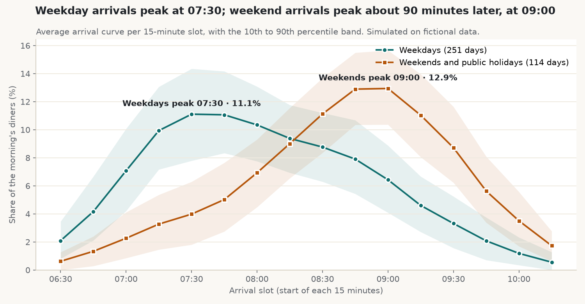
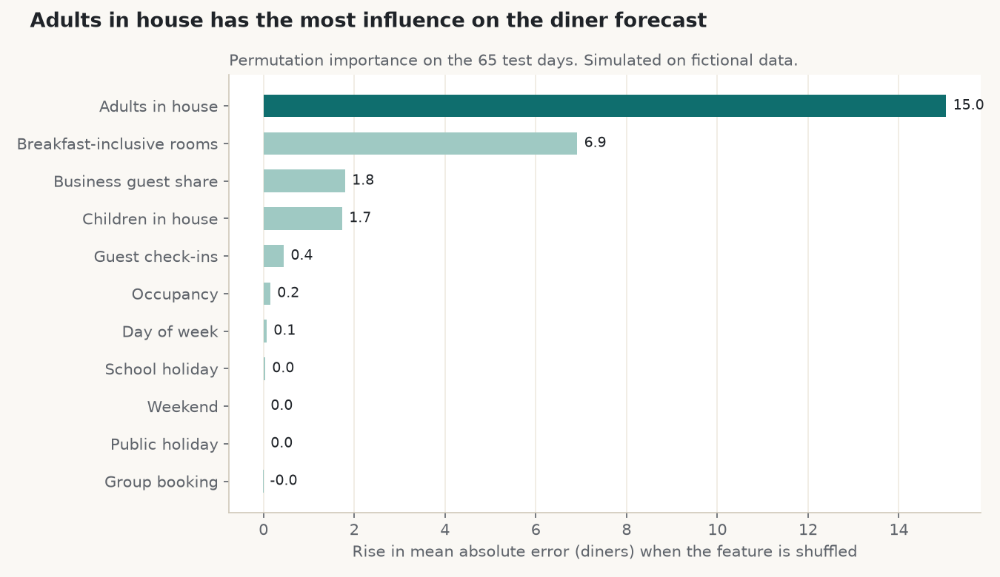
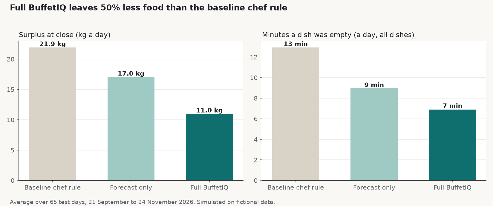

# Evidence

This file collects every metric, chart and test result in one place for the showcase slides. Each phase adds its section, and every result here is simulated on fictional data.

## At a glance

| Area | Result | Section |
| --- | --- | --- |
| Night-before diner forecast | Misses by 9.1 diners a day (3.2%) against 20.3 (7.2%) for the same-weekday baseline | Phase 2 |
| Dish forecast | Beats the baseline for all eight dishes, by 19% to 39% | Phase 2 |
| Guest booking to kitchen board | 1.8 to 2.9 seconds in browser tests (target 5 seconds) | Phases 3 and 8 |
| Leftover food at close (65 days) | 11.0 kg a day with BuffetIQ against 21.9 kg under the chef rule (-50%) | Phase 5 |
| Food cost of leftovers (65 days) | S$59.9 a day against S$119.6 (-50%, about S$21,800 a year) | Phase 5 |
| Minutes a dish was empty (65 days) | 6.9 a day against 12.9 | Phase 5 |
| Ask BuffetIQ, scripted questions | 20 of 20 match the board typed, 20 of 20 spoken (median 0.83 seconds); 10 of 10 on added topics | Phase 6 |
| Forecast learning | Error 7.3% with 1 month of history, 3.3% with 10 months, on the same test days | Phase 7 |
| Camera tray check | 4 of 4 printed demo cards right; 1 of 4 held-out grid photos right (32 AI-generated training photos, too few for a reliable accuracy) | Phase 4 |
| Gemini answers | Flash-Lite: 13 of 20 typed questions match the board (most misses leave out the dish name, none has a wrong number), median 1.4 seconds; Flash: the free tier allows only 20 requests a day | Phase 6 |
| Tests | 254 automated tests pass | All |

Two engine bugs were found and fixed after the first replay results had been seen; both are disclosed in Phase 5. Not every morning improves: on the data's demo morning BuffetIQ left more food than the chef rule (Phase 7).

## Phase 0: setup and static screens

Phase 0 has no models, so its evidence is the test suite and the screen comparison. The test suite (`python -m pytest -q`) checks the configuration, the colour tokens from CLAUDE.md, text contrast of at least 4.5:1 for every text and background pair in both modes, the absence of em dashes in on-screen copy, the "Fictional data" labels, accessible names for symbol-only buttons, that all five pages build, and that no API key is committed.

## Phase 1: synthetic data

This section shows that the fictional hotel's year of breakfasts behaves as intended, before any model sees it. The data covers 365 breakfasts at a fictional 300-room Singapore city hotel from 25 November 2025 to 24 November 2026. It is simulated on fictional data, with every assumption and its source in `docs/ASSUMPTIONS.md`.

The data was frozen on 21 November 2026, before Phase 2 began. The file `data/synthetic_breakfast.csv` (365 rows, 65 columns, generated with seed 20261124) has the SHA-256 checksum `86846b20aca06899e35f41c1546282924d0ccd92a01cb5f8f375dc1df7497022`, and `tests/test_data_gen.py` fails if it changes.

The year averages 282 diners a day (265 on weekdays and 319 at weekends and on public holidays, from 200 to 412), with 83% occupancy, 78.3% of rooms including breakfast and check-ins from 21% of diners. There are 37 group days and 32 surprise days (14 rain, 13 early tour groups, 4 early events and 1 quiet morning).

Weekday arrivals peak in the 07:30 slot (11.1% of the morning), with 39% of diners arriving between 07:00 and 08:00. Weekend and public holiday arrivals peak in the 09:00 slot (12.9%), with 48% arriving between 08:30 and 09:30.

Under the baseline chef rule (same-weekday average over four weeks plus 15%), an average day has these amounts per dish, with croissants converted at 60 g each:

| Dish | Prepared (kg) | Eaten (kg) | Left (kg) | Left (% of prepared) | Days demand exceeded the plan | Cost of leftovers (S$ a day) |
| --- | --- | --- | --- | --- | --- | --- |
| Scrambled eggs | 22.3 | 19.0 | 3.3 | 14.8 | 47 | 16.52 |
| Chicken sausages | 15.9 | 13.3 | 2.6 | 16.3 | 27 | 19.37 |
| Hash browns | 11.6 | 9.6 | 1.9 | 16.7 | 32 | 7.69 |
| Pancakes | 7.3 | 6.1 | 1.1 | 15.7 | 55 | 5.12 |
| Mee goreng | 16.4 | 13.6 | 2.8 | 17.1 | 33 | 9.79 |
| Nasi lemak rice | 19.1 | 16.0 | 3.1 | 16.3 | 40 | 7.75 |
| Croissants | 8.5 | 6.8 | 1.7 | 20.4 | 24 | 20.79 |
| Cut fruit | 22.4 | 18.5 | 4.0 | 17.6 | 28 | 19.00 |
| **Total** | **123.3** | **102.8** | **20.5** | **16.6** | | **106** |

That is 73 g of leftovers per diner, close to the 62.2 g per guest measured by the Dutch Hotel Monitor, and about S$38,700 a year. It is about half the "usual day" on the day-end report design (41.2 kg, S$214), so later phases will compare BuffetIQ with these simulated figures rather than the design's sample numbers.

The sanity tests in `tests/test_data_gen.py` (17 tests) check that there are no negative numbers, that arrivals add up to diners every day, that leftover equals prepared minus consumed, that prepared amounts are whole batches, that monthly occupancy is within 1 point of the STB figures, that the weekday and weekend peaks fall in the required windows, that children raise pancake demand, that surprises occur on 3% to 11% of days and that check-in response never exceeds 40%. All 96 tests in the project pass.

## Phase 2: demand forecast for the night before

This section shows whether the night-before forecast is better than what a kitchen does today. The forecast predicts how many guests will eat, when they will arrive in each 15-minute slot, and how much of each dish they will need, using only what the hotel knows the evening before. It is compared with the usual planning shortcut, the average of the same weekday over the previous four weeks. Every result is simulated on fictional data, and the numbers come from `python -m buffetiq.forecast` (run from `src`), also available as `notebooks/02_evaluate_forecast.ipynb`, with the raw output in `docs/phase2_results.json`.

The models are trained on the first 300 days (25 November 2025 to 20 September 2026) and tested once on the last 65 (21 September to 24 November 2026), so they never see the future. Every choice of settings and method was made on the training days alone, through time-ordered cross-validation (each fold is predicted by a model trained only on earlier days). Error is reported as MAE (mean absolute error, the average miss), RMSE (root mean squared error, which punishes large misses more) and MAPE (mean absolute percentage error).

### Diners

A Random Forest (an average of 300 decision trees) uses the day of week, the weekend, public holiday and school holiday flags, occupancy, adults and children in house, breakfast-inclusive rooms, the business guest share, the group booking flag and guest-page check-ins. Its best settings from the training days were trees grown to a maximum depth of 12 with leaves of one day.

| Method | MAE (diners) | RMSE (diners) | MAPE |
| --- | --- | --- | --- |
| Random Forest | 9.1 | 11.8 | 3.2% |
| Same weekday, last 4 weeks | 20.3 | 27.0 | 7.2% |

The forecast more than halves the baseline's error, missing by 9 diners on an average test day of 280. The largest misses are on 21 and 22 November, the first weekend of the school holidays, when 383 and 351 guests came against forecasts of 348 and 339, though the baseline missed those days by 74 and 42.

Permutation importance measures how much worse the forecast gets when one feature's values are shuffled across the test days. Adults in house matters most (shuffling it adds 15.0 diners to the average miss), followed by breakfast-inclusive rooms (6.9), the business guest share (1.8) and children in house (1.7). Check-ins add only 0.4, as intended, because they cover between 0% and 40% of guests. Day of week and the holiday flags score close to zero, not because they do not matter but because their effect already shows up in the guest counts and the business share. This also reflects a limit of synthetic data: diners were generated from these same counts, so real hotel data would contain more unexplained variation and a larger error.

### Arrival curve

Two ways of predicting each slot's share of the morning were compared: a Random Forest per slot (using day type, holidays, business share, group flag and the share of children), and a simple average profile for weekdays and for weekends and public holidays. On the training days, through cross-validation, the model's average error per slot was 1.40 percentage points against 1.41 for the profile, less than the 5% improvement set in advance as the bar for choosing the more complex method, so the average profile is used. The test days agree: the model would have been 1.33 points against 1.39, a 4.5% gain, still inside that bar. The profile is easier to explain and cannot overfit, and most of the day-to-day variation in arrivals is random rather than predictable from the features. Turned into diners per slot, the forecast misses by 4.0 diners per slot against 4.5 for the same-weekday baseline.

### Dishes

Each dish's amount is a predicted rate per diner multiplied by predicted diners. The rate either comes from a small linear regression on the business share, the share of children in house and the weekend flag, or is a fixed average; the regression was kept for a dish only if it beat the fixed rate on the training days, which it did for five dishes. Days when a dish ran out (everything prepared was eaten) were left out when fitting rates, because what was eaten on those days understates appetite. The test days are scored against the simulation's true demand, which the models never see.

| Dish | Unit | MAE | MAPE | Baseline MAE | Baseline MAPE | Rate method |
| --- | --- | --- | --- | --- | --- | --- |
| Scrambled eggs | kg | 0.99 | 5.1% | 1.48 | 7.7% | Guest mix |
| Chicken sausages | kg | 0.76 | 5.7% | 1.01 | 7.7% | Fixed |
| Hash browns | kg | 0.61 | 6.2% | 0.88 | 8.9% | Fixed |
| Pancakes | kg | 0.47 | 7.3% | 0.66 | 10.7% | Guest mix |
| Mee goreng | kg | 0.88 | 6.3% | 1.27 | 9.3% | Guest mix |
| Nasi lemak rice | kg | 1.14 | 7.0% | 1.87 | 11.5% | Guest mix |
| Croissants | pieces | 7.7 | 7.0% | 10.8 | 9.7% | Guest mix |
| Cut fruit | kg | 1.34 | 7.0% | 1.65 | 8.7% | Fixed |

The forecast beats the baseline for every dish, cutting the average miss by between 19% (cut fruit) and 39% (nasi lemak rice). The RMSE figures, in `docs/phase2_results.json`, show the same ranking. The guest-mix rate helps most for pancakes (0.47 kg against 0.53 kg with a fixed rate), because children raise pancake demand.

### Shopping list

The shopping list buys for the 80th percentile, a morning busier than four in five forecasts, and turns finished amounts into raw ingredients with the recipe card in `config.yaml`. The margin above the central forecast is set from the training days' out-of-fold predictions: how far actual amounts ran above the forecast on four days in five (4% to 8% depending on the dish). On the test days, the margin covered true demand on 68% (pancakes) to 86% (eggs and hash browns) of days, about 77% on average across dishes, and actual diners on 92% of days. Pancakes fall short because school holiday demand in the last week of the test period was higher than anything in the training year's margin. The first attempt used the spread of the forest's trees, which covered only 65% to 74% of days for dishes because it ignores day-to-day appetite. We changed the method after seeing that test coverage, so the test days have been looked at twice for this one setting; the figures above should be read with that in mind.

For the demo morning, Tuesday 24 November 2026, the forecast is 306 diners (291 actually came) and the shopping list includes 415 eggs, 16.7 kg of chicken sausages, 11.7 kg of frozen hash browns, 7.3 kg of rice, 128 croissants and 34.5 kg of whole fruit.

### Verdict

The forecast beats the baseline on the test days for diners, arrivals per slot and all eight dishes. Its accuracy is flattered by synthetic data generated from the same guest counts it uses, so Phase 5 will test what matters more, whether it reduces leftovers and stock-outs when the morning is replayed slot by slot.

## Phase 3: guest flow and live check-ins

This section shows that what a guest tells us on their phone reaches the kitchen board quickly and changes the forecast by a justified amount. The guest page has the three designed steps (breakfast plan, choose a time, confirmed), plus a thank-you screen for guests who reply "Not this time". Every result is simulated on fictional data.

An automated browser test (Playwright, with a 390 x 844 phone screen and the board at 1920 x 1080) booked two guests for room 1410, chose 08:00, accepted the "Switch to 09:30" suggestion and confirmed. The board's forecast outlines changed 2.9 seconds after the tap, within the 5-second refresh. A second phone then replied "Not this time" for two guests, and "Expected today" fell from 299 to 298 at the next refresh.

On the demo morning (Tuesday 24 November 2026) the forecast is 300 diners before any live check-ins. The crowd view marks 07:00 to 08:30 as Busy, 09:00 as Moderate, and 06:30, 09:30 and 10:00 as Quiet, so choosing 08:00 suggests 09:30. The design screen shows 09:00 as Busy; in the simulated data the Tuesday rush ends earlier, and we have not changed the data to match the screen.

A confirmation feeds the Random Forest through its check-in count, so it moves "Expected today" only as much as the evidence supports. A guest who confirms was already likely to eat breakfast (66% of in-house guests do on the demo morning), so one party of two usually changes the forecast by less than one diner. The visible change is in the arrival curve, where confirmed guests are placed in their chosen half hour. Twenty confirmed parties of two raise the forecast by much less than 40, which the tests check, because adding them on top would double count guests the forecast already expected. Each declined guest lowers the forecast by 0.66, the chance they would have come.

Because one party barely moves the total, a first test on a real phone looked as if nothing had happened, so each booking now also appears in the board's Alerts panel, newest first, such as "2 guests booked for 09:30" with the new expected total (and no room number). In the browser test the alert appeared 0.7 seconds after the guest tapped Confirm. The same test also found that a reply could be recorded as "Not this time" when the choice had not loaded; now only an explicit "Not this time" counts as a decline.

The 23 tests in `tests/test_guest_flow.py` check the Quiet, Moderate and Busy thresholds, that the crowd view adds two 15-minute slots per half hour, that slot forecasts add up to the expected total, that confirmed guests land in their half hour, that declines lower the forecast, that "Change my plans" replaces the room's earlier plan, that meal counts are capped at the party size, that room numbers must have 3 to 5 digits, that plans survive a restart and are deleted after checkout, that the file is ignored by git, that half hours which have ended cannot be chosen on the morning itself, that the QR link works on the local network and through a share link, and that booking alerts never show room numbers. All 129 tests in the project pass.

## Phase 4: camera tray check

This section reports how accurately the camera model judges tray levels from images it has never seen. The model was trained on 23 November 2026 on AI-generated images: eight 2 by 2 grids made in the Gemini app (two per level, see `docs/GENERATED_PHOTOS.md`), cut into 32 photos, 8 per level. Results are in `docs/phase4_camera_results.json` and `docs/charts/phase4_confusion_matrix.png`. All images are AI-generated, not real phone photos, so these numbers say how the model handles Gemini's trays, not a real buffet.

| Check | Images | Right | Notes |
| --- | --- | --- | --- |
| Held-out test photos, cut from the grids | 4 (1 per level) | 1 of 4 (25%) | Empty right; the three noodle trays in the patterned foil tray were wrong (Low read as Full, Half as Low, Full as Half) |
| Printed demo cards, made separately, never trained on | 4 (one per level) | 4 of 4 | Empty 99%, Low 100%, Half 87% and Full 97% sure; the Empty card was scored after training, with the same model |

The two checks disagree, and with so few images neither is a reliable accuracy: each test photo is worth 25 percentage points, and all three test errors are one dish in one tray, whose pressed foil pattern and tangled noodles look alike at every level. The 60% confidence rule caught two of the three errors (shown as "Not sure about this one", so nothing reached the board), but Half read as Low at 83% would have been sent. One error was more than one level off (Low read as Full, at 55%, so not sent). The honest summary is that the camera reads all four demo cards correctly and is unreliable on the hardest dish, so "Wrong level? Fix it" remains part of the design, not only a backup. More grids per level are the clearest way to improve it.

The first training run kept the round with the best validation score and stopped early. With one validation photo per level, that score is noise, so it kept round 1 (before the model had learned much) and scored 25% on the test photos and 2 of 3 demo cards. Training on sets with fewer than 5 validation photos per level now runs a fixed 100 rounds and keeps the last one. That rule was chosen for the small set before seeing the second result and applied once; it was not adjusted against the test photos or the demo cards.

The weakness found with the stand-in model remains: a plain grey image is read as Full at 53% (not sent) and a plain white one as Full at 68% (sent). A confidence threshold catches photos the model finds ambiguous, not photos of something that is not a tray, so runners still need to glance at the result.

The photos are split 70% for training, 15% for validation (used only to pick the best training round) and 15% for testing, with each level's share kept in every part, so the test photos are never seen in training. Ultralytics' own automatic split (80% training, 20% validation) was not used, because it would leave no untouched test photos.

Before the photos exist, the pipeline was checked end to end with a throwaway model trained on 240 computer-drawn tray images. Its accuracy is not reported, because drawn trays say nothing about real ones. With it, an automated browser test on a 390 x 844 phone screen confirmed that "Check tray" opens the phone camera, a photo of a low tray returns "Low" with a confidence pill and "About 0.4 kg left of 2.5 kg", the kitchen board's egg card changes to Low within 5 seconds, "Wrong level? Fix it" saves the photo into the corrected level's folder, the manual buttons work on another station, and "Record leftovers" writes to the service log without changing the board.

With the stand-in model, a plain grey image, which is not a tray at all, was classified as Empty with 85% confidence; the trained model's behaviour on such images is reported above.

The 16 tests in `tests/test_camera.py` check the amount formula (pan capacity times 0, 0.15, 0.5 or 0.9), the wording against the design, that results below 60% confidence are not sent, that a missing model falls back to the manual buttons, that sure, manual and leftover results reach the board or the history correctly, that the log holds no guest data, that corrections are saved in the right folder, that the split keeps every level in each part with no overlap, and that the photo check flags shortfalls and copies.

## Phase 5: nowcast, refill engine and kitchen board

This section tests BuffetIQ's central claim: that guiding the kitchen during service, rather than only planning the night before, cuts leftover food without leaving trays empty. Every result is simulated on fictional data, from `python -m buffetiq.simulate` (run from `src`), with the raw output in `docs/phase5_results.json`.

### How the replay works

Each of the 65 test mornings (21 September to 24 November 2026) is replayed in 5-minute steps from 06:30 to 10:30, with guests arriving as they did in the synthetic data and eating each dish in proportion to their arrivals, up to that day's true demand. Every policy opens with one full pan of each dish. Food left on the buffet, held in reserve or still cooking at 10:30 counts as surplus, and a stock-out minute is a minute in which a dish's tray was empty while guests wanted it.

1. **Baseline chef rule.** The chef cooks the day's planned amount from the data (the same-weekday four-week average plus 15%) through the morning, following the usual arrival curve for that day type, and cooks one more batch whenever a tray is empty with nothing cooking.
2. **Forecast only.** The same, but the planned amount is the night-before forecast plus the 10% buffer, spread along the forecast arrival curve.
3. **Full BuffetIQ.** The nowcast and refill engine from `src/buffetiq/nowcast.py`, the same code that drives the live kitchen board. It sees only the arrivals the host logs and a camera reading of each tray every 15 minutes, given as Empty, Low, Half or Full and right 85% of the time (otherwise one level off), until the group's photos give a measured accuracy. Its calls are assumed to be followed, and hot dishes switch to cook-to-order when fewer than 12 guests per 15 minutes are expected for the rest of service.

### Results

| Policy | Surplus at close (kg a day) | Change | Cost of surplus (S$ a day) | Change | Stock-out minutes (a day, all dishes) | Change |
| --- | --- | --- | --- | --- | --- | --- |
| Baseline chef rule | 21.9 | | 119.6 | | 12.9 | |
| Forecast only | 17.0 | -22% | 95.5 | -20% | 8.9 | -4.0 |
| **Full BuffetIQ** | **11.0** | **-50%** | **59.9** | **-50%** | **6.9** | **-6.0** |
| BuffetIQ without cook-to-order | 11.8 | -46% | 63.6 | -47% | 14.3 | +1.4 |

Full BuffetIQ halves the surplus at close compared with the baseline chef rule, from 21.9 kg to 11.0 kg a day, and halves its food cost, from S$119.6 to S$59.9 a day (about S$21,800 a year for this fictional hotel), while cutting the minutes a dish stands empty from 12.9 to 6.9 a day. It therefore meets the bar set for this phase: less surplus without more stock-out minutes. It also beats forecast only on both measures.

### Corrections made after the first replay

Two bugs in the engine were found and fixed after the first test results had been seen, so these figures should be read with that in mind. Neither fix changed the data, the forecast or any setting; both made the engine behave as described.

1. **Late slots looked busy, so cook-to-order never started.** Expected arrivals in each later slot were divided by the share of the morning left after that slot instead of after the current time, so the last 15 minutes looked like 234 guests. Found in Phase 5; a regression test now guards it.
2. **A camera reading wiped out food held in reserve.** The camera sees only the pan on the buffet, but a reading replaced BuffetIQ's whole stock estimate, so when it misread a full pan as half (as it does 15% of the time in the replay), BuffetIQ forgot the food held hot in the kitchen and called for more. Found in Phase 7, when the demo morning's report showed 16.5 kg of mee goreng cooked for 12.4 kg of demand. A reading now updates only the pan, keeps the reserve, and an Empty reading is trusted fully.

Before these fixes, the same replay gave full BuffetIQ 17.6 kg of surplus (-20%) and 5.7 stock-out minutes. The correction mostly removed over-cooking, at the cost of about one more empty minute a day.

### Findings that are less flattering

1. **Without cook-to-order, stock-outs rise slightly** (14.3 minutes against 12.9 for the baseline), so the switch matters for keeping trays filled late in the morning, when BuffetIQ now cooks less.
2. **Brief empty trays happen on more days.** BuffetIQ has more days with any empty minute for several dishes (for example 18 against 9 days for hash browns), though the minutes are fewer in total; with a 15-minute check interval, a dish with a 12-minute cooking time can run out between checks. Croissants are also empty slightly longer (0.4 against 0.1 minutes a day).
3. **Not every morning improves.** On the demo morning, Tuesday 24 November, BuffetIQ leaves 17.9 kg against 14.6 kg under the chef rule (see Phase 7), because that morning's guests ate less mee goreng per head than forecast while the chef's same-weekday plan happened to be close.

| Dish | Surplus, baseline (kg) | Surplus, BuffetIQ (kg) | Stock-out min, baseline | Stock-out min, BuffetIQ | Cost, baseline (S$) | Cost, BuffetIQ (S$) |
| --- | --- | --- | --- | --- | --- | --- |
| Scrambled eggs | 3.77 | 1.63 | 1.1 | 0.3 | 18.87 | 8.13 |
| Chicken sausages | 2.69 | 1.37 | 1.0 | 0.7 | 20.21 | 10.27 |
| Hash browns | 1.89 | 0.80 | 2.5 | 1.3 | 7.55 | 3.21 |
| Pancakes | 1.23 | 0.45 | 1.5 | 1.1 | 5.52 | 2.02 |
| Mee goreng | 2.75 | 1.28 | 1.5 | 1.2 | 9.63 | 4.47 |
| Nasi lemak rice | 2.99 | 1.71 | 4.0 | 1.2 | 7.47 | 4.27 |
| Croissants | 2.60 | 1.33 | 0.1 | 0.4 | 31.22 | 15.98 |
| Cut fruit | 3.99 | 2.40 | 1.3 | 0.7 | 19.14 | 11.51 |

In the last hour, BuffetIQ flagged an average of 9.6 kg a day as likely surplus for a Treatsure offer. These flags are not subtracted from the surplus above, because the replay cannot know how much would actually sell.

### Sensitivity test: guests who accept a quieter half hour

This is a sensitivity test, not a prediction. It moves a share of the guests in each Busy half hour of the forecast to the nearest Quiet one and replays full BuffetIQ.

| Share of guests who accept | Surplus (kg a day) | Stock-out minutes (a day) | Cost (S$ a day) |
| --- | --- | --- | --- |
| 0% | 11.0 | 6.9 | 59.9 |
| 10% | 8.9 | 6.2 | 48.1 |
| 20% | 7.4 | 9.5 | 41.6 |
| 30% | 7.0 | 17.8 | 38.8 |

Up to about 10%, a flatter rush helps on both counts. Beyond that, the moved guests turn the quiet half hours into new peaks and stock-out minutes rise sharply, because in this test the forecast curve does not learn where the guests went. In the live app, guests who choose a time on the guest page are placed in their half hour, so the real effect should sit between these figures, but this replay cannot show that.

### Changes worth trying

The 45-minute cover window, the 10% buffer, the 15-minute check interval and the cook-to-order threshold of 12 guests per 15 minutes were set before any results were seen and have not been tuned. Checking fast-cooking dishes more often, or cooking a little earlier when the pan reads Half, would probably reduce the brief empty trays, but any such change should be chosen on training days and tested once on these 65 days, not tuned against them.

### The live kitchen board

The kitchen board now runs entirely on the engine, apart from the last voice answer (Phase 6). Started with `python app.py --at 08:40`, it replays the demo morning to 08:40 with simulated guests and camera checks. It then shows 223 diners so far, "Expected today 310, was 300", Moderate for the next 15 minutes, arrivals 5% ahead of forecast, chicken sausages Empty with "Cook 3.75 kg · Now · ready in 5 min" (it read "Cook 5 kg" before the reserve fix), the other dishes on Hold with their reserves, pan timers, and the stop-out and cook-to-order alerts. "Log arrivals +5" raised the expected total from 310 to 315 at the next refresh, "Override a call" changed scrambled eggs to "Let it run down" with the chef's reason shown on the card, and "Check a tray" shows a QR code for the runner page.

The tests in `tests/test_nowcast.py` cover zero arrivals, the nowcast formula, refill rounding, the lead-time cut-off, the pan timer thresholds (3 hours 30 minutes and 4 hours), the slot arrivals bug, cook-to-order timing, calls being followed only once, stop-out alerts, overrides and discards, Treatsure flags only in the last hour, the camera error model, conservation of food in the replay, and the live board after a replay.

## Phase 6: Ask BuffetIQ voice assistant

This section shows whether chefs get the same numbers by asking aloud as by reading the board. Ask BuffetIQ turns speech into text with faster-whisper ("small", running on the laptop), answers from five functions that read the kitchen engine (`get_refill_plan`, `get_stock`, `get_forecast`, `get_timer` and `get_alerts`), and speaks the answer with gTTS while showing the text. With a Gemini key, Gemini chooses the functions and words the answer; every number in its answer is then checked against the function results, and if one does not match, the rule-based answer from the same results is used instead. Without a key, with the free tier rate limited, or offline, a rule-based intent parser answers the same five question types and the status pill reads "Basic answers". Every result is simulated on fictional data, from `python -m buffetiq.assistant_eval` (run from `src`), with every question and answer in `docs/phase6_results.json`.

Twenty kitchen questions were asked on the demo morning replayed to 08:40, covering what to cook for each of the eight dishes, what is running low, tray levels, guests expected and so far, the next 15 minutes, pan timers, last cook and bake times, alerts, and one question the board cannot answer (the weather). Each expected answer is read from the board at that moment, such as "Cook 3.75 kg" and "sausage" for "Do we need more sausages?", and an answer matches when it contains every expected fact. The run was repeated after the Phase 7 engine fix changed the board, with the same result.

| Run | Answers matching the board | Median response time |
| --- | --- | --- |
| Typed, basic answers (no Gemini) | 20 of 20 | under 0.01 seconds |
| Spoken by a computer voice (gTTS), then faster-whisper and basic answers | 20 of 20 | 0.88 seconds |
| Typed, Gemini (gemini-3.5-flash-lite, 24 November 2026) | 13 of 20 (8 of 10 on added topics) | 1.37 seconds |
| Spoken by a computer voice, then faster-whisper and Gemini Flash-Lite | 13 of 20 | 2.08 seconds |
| Spoken in a real voice (5 recordings) | **not yet run: waiting for recordings** | |

The basic answers, which also serve as the fallback, meet the target of at least 18 matching answers with the key removed. faster-whisper heard 19 of the 20 computer-voiced questions word for word, writing "Any pans near four hours." for "Any pans near 4 hours?", which still answered correctly. The test is easier than real service in two ways, so the figures above are an upper bound: at 08:40 seven of the eight dishes are on Hold, so most refill answers are the same word, and the computer voice is clearer than a chef talking over a busy kitchen. A real-voice run in noise is the more honest test of the microphone.

The Gemini runs were made on 24 November 2026 with a free-tier key. gemini-3.6-flash came first, but the free tier allows that model 20 requests a day per project and each question needs two or three (one to choose the function, one to word the answer), so it answered 8 questions, taking 13 to 32 seconds each, before the limit was reached and BuffetIQ fell back to basic answers, as designed. That is too few for a showcase, so gemini-3.5-flash-lite was used instead. It answered every question, with a median of 1.4 seconds, and the number check rejected none of its answers. Of the 7 typed answers that did not match, 5 gave the board's call without naming the dish ("Hold. Next check 08:55."), 1 gave the right amount in other words ("There are 2.5 kg of scrambled eggs left on the tray" for a Full tray), and 1 did not answer the question ("When do I stop croissants?" was answered "Hold" rather than with the 09:50 last bake time). On the added topics it left out that hash browns are vegetarian, and its "We haven't thrown away any food so far" was right but did not use the expected word. Gemini's answers read more naturally but are less complete than the basic answers, and scored strictly they miss the target of 18 of 20. The results file now holds the Flash-Lite run.

In an automated browser test (before the Phase 7 engine fix), holding the phone's microphone button for 3 seconds with a recorded question ("How much sausage should I cook?") returned "Cook 5 kg of chicken sausages now. The tray has been empty since 08:35." 1.5 seconds after release, matching the board at the time, and the spoken answer played and could be replayed. The same question from the kitchen board's "Hold to ask BuffetIQ" button updated the "Last voice answer" panel and was spoken through the laptop.

Browsers allow the microphone only on secure links. The laptop's own board (opened as `127.0.0.1`) and the Colab share link (`https`) can record, but a phone opening the app as `http://192.168.x.x` cannot; there, the button explains this and offers typing, which is the "no microphone" fallback.

The tests in `tests/test_assistant.py` cover dish synonyms in kitchen language, removing room numbers before anything leaves the laptop, the intent parser, answers that repeat the board's call, the reply when the board cannot answer, rejecting a Gemini answer whose numbers do not match the board, falling back and pausing Gemini after an error such as a rate limit, the "Basic answers" pill without a key, text-only answers without internet, microphone problems offering typing, and logging without guest data.

## Phase 7: day-end report, history and retraining

This section shows what the F&B manager sees after service and whether the forecast learns from each day. Every result is simulated on fictional data.

### The day-end report for the demo morning

The report finishes the morning to 10:30 on a copy of the kitchen, so the live board is not changed, and compares it with the same morning (the same 291 guests and the same demand) replayed under the usual chef rule. Any dish the runner records with "Record leftovers" uses that figure instead, and discarded pans count as waste.

| Figure | Today, with BuffetIQ | A usual day (chef rule) |
| --- | --- | --- |
| Food left over | 17.9 kg | 14.6 kg |
| Cost of food wasted | S$85 | S$86 |
| Minutes a dish was empty | 22 | 9 |
| Guests served | 291 (forecast 300) | 291 |

On this particular morning BuffetIQ does worse than the chef rule on leftovers (22% more) and empty minutes, and about the same on cost. Most of the extra leftovers are mee goreng (5.6 kg against 2.6 kg): the forecast expected 0.047 kg per guest, but this morning's guests ate 0.043 kg each, while the chef's same-weekday average happened to be close. Most of the empty minutes are hash browns, empty from 09:02 to 09:15 because a 12-minute cook started at a 09:00 check. Across all 65 test days BuffetIQ halves leftovers (Phase 5), so this morning is an unlucky one rather than the rule, and we have not changed anything to make it look better. If the group wants a demo morning that shows the typical result, it should be chosen by a rule fixed in advance (for example, the median day of the 65), not by trying mornings until BuffetIQ wins.

"What happened today" lists up to four events from the engine and the log. On the demo morning they were: hash browns ran out for 13 minutes (empty from 09:02 to 09:15; the kitchen cooked 2 kg), 12.4 kg offered on Treatsure (croissants, nasi lemak rice and 5 more, flagged from 09:30), and cook-to-order from 09:20.

### Forecast keeps improving

The design shows forecast error falling week by week. Measured honestly, it did not: training on 4, 5, 6 and 7 weeks of history and testing each on the following week gave errors of 7.2%, 4.5%, 9.1% and 6.5%, because each week is different (some contain holidays). Testing every version on the same 65 test days separates learning from how hard a week happens to be, and shows the forecast clearly improving as history grows, so the chart uses this measure, labelled by months of use:

| History used | Average error in guests per day (same 65 test days) |
| --- | --- |
| 1 month (4 weeks) | 7.3% |
| 2 months (8 weeks) | 5.3% |
| 3 months (12 weeks) | 4.2% |
| 10 months (42 weeks) | 3.3% |

### Retraining and the NEA file

"Retrain tonight" saves today's service as a history row (its prepared, eaten and left amounts replace the synthetic row for that date), retrains the forecast on all 365 days, saves it, and compares tomorrow's forecast with last night's model, which did not know about today. For Wednesday 25 November it gave 289 guests, 0.3 fewer than before retraining, in 2.3 seconds. One extra day among 365 moves the forecast by less than one guest, as expected; the learning table above shows the effect of weeks and months of days.

"Export NEA waste file (CSV)" downloads 2,920 rows, one per day and dish for all 365 days, with food waste in kilograms and a source column marking each day as simulated history or a logged service. NEA's reporting template asks for food waste by period, so this file is a starting point to adapt, not the template itself.

Every action is appended to `data/service_log.csv`: arrivals, tray checks, cook calls followed, batches out, cook-to-order, overrides, discards, leftovers, voice questions (with room numbers removed) and retraining.

The 8 tests in `tests/test_reports.py` check that the report balances (prepared equals eaten plus left for every dish) and leaves the live board alone, that recorded leftovers and discards are used, the report's wording, that the learning curve falls with more history, that a logged day replaces its synthetic row, that the NEA file has every day and dish, that retraining changes tomorrow's forecast and saves the model, and that the engine's cook calls reach the log.

### Topics added after Phase 7

Ask BuffetIQ was extended with five more functions so that it can answer more of what cooks ask during service, still only from data: `get_dietary` (halal and vegetarian status, and today's halal and vegetarian meal counts from the guest page, as counts only), `get_allergens` (allergens per dish from the recipe card), `get_food_safety` (Singapore Food Agency holding rules and the kitchen's reuse policy), `get_call_reason` (why the board makes its call, from stock, reserve, expected guests and need) and `get_waste` (food thrown away so far and food likely to be left at close). Each has a rule-based answer, so it also works without Gemini.

Ten extra questions were scored separately, so the brief's 20 stay unchanged. All 10 matched with basic answers, for example "Does the mee goreng have peanuts?" answered "No, mee goreng has no peanuts. Its recipe card lists gluten, soy and egg." and "Why cook more sausages?" answered with the board's call and the guests expected in the next hour. With the extra functions in place, the original 20 typed questions still matched 20 of 20, and the 20 spoken questions matched 20 of 20 with a median of 0.83 seconds. The new tests in `tests/test_assistant.py` cover the new intents, dietary answers from the config, dietary counts without room numbers, allergen answers, the SFA temperatures, the "why" answer repeating the board's call, and waste answers whose numbers match the function results.

## Phase 8: showcase mode and the demo rehearsal

This section records whether the five-minute demo works end to end. The prepared showcase morning is a fictional Tuesday 24 November at 82% occupancy with an unannounced tour group of 24 arriving at 07:45; it is built from the data's demo morning (guests, arrivals and demand scaled to 82% occupancy), and the tour group is not in the night-before features, so only the nowcast can catch it. Opening pans now go out at 06:20, ten minutes before service, which starts their 4-hour timers; this changes only the timer display, not any result.

An automated browser rehearsal on 22 November 2026 ran all seven steps. The guest page marked 07:00 to 08:30 Busy and 09:30 Quiet; a booking at 08:00, switched to 09:30, appeared on the board 1.8 seconds after Confirm. Jumping to 08:00 showed "Tour group of 24 arrived at 07:45 · Expected diners raised from 277 to 306". At 08:40 a Low photo of the pancake tray turned its card into "Cook 1.5 kg · Now · ready in 6 min", and Ask BuffetIQ answered "Cook 1.5 kg of pancakes now. Ready in 6 minutes." At 09:50 the hot dishes showed "Cook to order" and Treatsure offers appeared for eggs, cut fruit and rice. The day-end report showed 11.7 kg left against 12.6 kg the usual way (7% less), S$59 against S$76 of food wasted, and 24 against 13 minutes with an empty dish, mostly hash browns during the tour group rush.

Three steps of the brief's demo were changed to match the data rather than the other way round. The guest picks 08:00, because in this data 09:00 is Moderate, not Busy. The tray photo is of pancakes, because at 08:40 BuffetIQ holds 2.2 kg of eggs in reserve and correctly says Hold for a low egg pan. No pan timer turns saffron at 09:50, because every pan was refreshed by a new batch during the busy morning; the timers are shown on the cards and tested in `tests/test_nowcast.py`.

The 7 tests in `tests/test_showcase.py` check the showcase morning's occupancy and unbooked tour group, loading it at 06:15, the tour group alert replacing the general forecast alert, reset, jumping back in time, the running clock and a photo counting as the truth for its tray.
